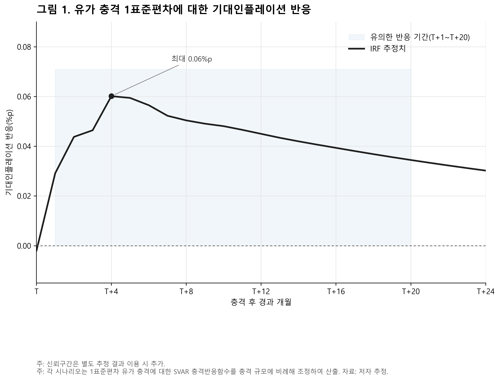
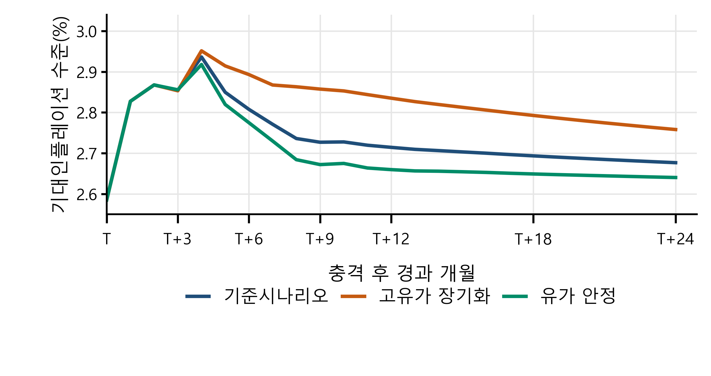

# Bank of Korea Monetary Policy Competition 2026

Code, data and results from our team's (통신보안) entry to the 23rd BOK Monetary Policy Competition.
The first round was a written report on the May 2026 rate decision. In the Seoul regional round we
presented on the July 2026 decision and recommended a 25bp hike (2.50% to 2.75%). We placed third
in the Seoul regional round.

My part was the SVAR below (estimation and diagnostics), the data pipeline behind it, and the real
economy section of the presentation.

## Question

After the Strait of Hormuz was closed in March 2026, Dubai crude went from $68.51 (February) to
$126.71 (March). How much does an oil shock like that move Korean households' 1-year-ahead inflation
expectations, and for how long?

## Model

4-variable VAR(3), monthly, 2010-02 to 2026-02 (193 observations), all from ECOS:

| variable | series | transform |
|---|---|---|
| oil | Dubai crude, USD/bbl (902Y003) | 100 x monthly log difference |
| FX | KRW/USD monthly average (731Y004) | 100 x monthly log difference |
| CPI | CPI, 2020=100 (901Y009) | STL seasonal adjustment, then 100 x monthly log difference |
| expected inflation | 1-year-ahead, consumer survey (511Y003) | level |

Identification is recursive (Cholesky) with the order oil, FX, CPI, expected inflation. Korea is a
small open economy, so oil goes first; expected inflation goes last on the assumption that people
update after seeing realized prices.

Choices made along the way, all in `reports/`:

- **Seasonality.** Raw CPI log differences had residual autocorrelation and a borderline ADF result
  (p = 0.053). After STL adjustment the ADF statistic is -11.25 (p < 0.001).
- **Lag length.** On the STL data the information criteria all pick 1 lag, but VAR(1) leaves
  autocorrelated residuals. VAR(3) passes the Portmanteau test at 6 to 24 lags and only fails the
  individual LM test at residual lag 6, so I used VAR(3).
- **Expected inflation in levels.** The level fails to reject a unit root in the ADF test (p = 0.106).
  I kept it in levels because the question is about the level of expectations in %p, and checked a
  first-difference version as a robustness model; the sign of the response doesn't change.
- **Ordering.** Swapping CPI and expected inflation gives the same oil-shock IRF, as it should: the
  first column of the Cholesky factor doesn't depend on how the later variables are ordered.

## Results

A one standard deviation oil shock (+8.05% in a month) raises 1-year expected inflation by up to
**0.060%p at T+4**, and the 95% interval stays above zero from T+1 to T+20. The CPI response is only
significant at T+1, so expectations stay up long after the price effect itself is gone.



Full IRF figure with bands for FX, CPI and expected inflation: `reports/figures/irf/oil_shock_irf_var3_stl_cpi.svg`

### Scenarios

I scaled the IRF by the size of each month's oil move (in units of the 8.05% shock) and summed
the responses. March and April use actual prices (126.71, 105.30), May uses 105.00, and after that
three paths:

| scenario | 2026 Q2 | Q3 | Q4 | 2027 | peak expected inflation | peak month |
|---|---|---|---|---|---|---|
| baseline | 100 | 90 | 87 | flat | 2.94% | T+4 |
| prolonged high oil | 105 | 105 | 105 | flat | 2.95% | T+4 |
| stabilization | 95 | 85 | 80 | flat | 2.92% | T+4 |

Starting level is the February 2026 value, 2.6%. The March shock alone is 7.64 standard deviations,
which is why the three paths end up close together. None of them reach 3%, but none come back to
2.6% within 24 months either.



The model also under-predicted actual expected inflation in March and April 2026 (by 0.115%p and
0.073%p), so I read these numbers as closer to a lower bound. It's a linear model, and a 7.6σ shock
is far outside anything in the sample.

Other runs that didn't go into the final report are also in `reports/`: the model re-estimated
through 2026-04, a year-over-year specification, a high-inflation-regime dummy and interaction
version, and the scenario paths from KIEP's war scenarios.

## Macro indicator workbook

`workbook/macro_indicator_workbook.xlsx` is the team's data workbook for the presentation: 110
indicators across policy rates, prices, growth, labor, trade, financial markets, credit, housing and
the global economy, monthly from 2025-01 to 2026-07. Each indicator has its release schedule noted so
we could tell what would be published before presentation day. The full list is in
`workbook/indicator_catalog.json`.

I also wrote scripts that rebuild it from ECOS and FRED going back to 2010
(`outputs/data_workbook_organized/`).

`presentation_charts/` has the charts and chart data made for the presentation slides.

## Running it

```
pip install -r requirements.txt
export ECOS_API_KEY=your_key     # PowerShell: $env:ECOS_API_KEY="your_key"
python scripts/fetch_ecos_data.py
python scripts/preprocess_and_adf.py
python scripts/stl_cpi_var_recheck.py
python scripts/estimate_irf_cholesky.py
python scripts/make_imf_expected_inflation_979x519_may_actual.py
```

The processed data is already in `data/processed/`, so the estimation and scenario scripts run
without an API key.

## Files

```
scripts/
  fetch_*.py, cache_ecos_*.py, match_ecos_tables.py      data collection (ECOS, FRED)
  validate_raw_data.py, preprocess_and_adf.py             cleaning, transforms, ADF tests
  eda_*.py                                                time series plots
  select_var_lag.py, stl_cpi_var_recheck.py,
  estimate_var_diagnostics.py, residual_lag_lm_acf.py,
  compare_stl_var_residual_lags.py, adf_stl_cpi.py        lag choice and residual diagnostics
  estimate_irf_cholesky.py                                main IRF
  robust_cholesky_swap_cpi_expectation.py                 ordering robustness
  hormuz_shock_simulation.py, scenario_*.py,
  custom_oil_path_preupdate_simulation.py, var3_*.py      scenario simulations
  rerun_updated_model_to_202604.py, yoy_model_to_202604.py  alternative specifications
  make_*.py                                               report figures
  *data_workbook*.py, build_*.py                          macro workbook
data/raw, data/processed     ECOS / FRED data
reports/                     test results, IRFs, scenario tables (markdown + csv), figures/
outputs/                     rebuilt 2010+ indicator workbook
workbook/                    team data workbook
presentation_charts/         slide charts
```
